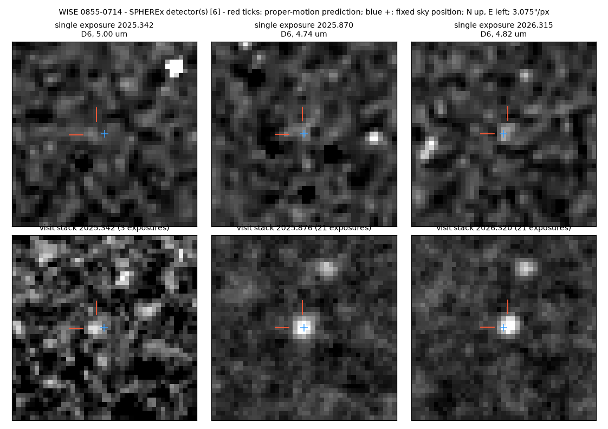

# SkyShift — SPHEREx Project Plan

Revision 2, 14 November 2026. Working name only. The first draft is kept unchanged as `SPHEREx_Project_Plan.v1.md`.

Project root: `/home/crow/planet`. Keep project source, configuration and implementation work in this directory.

**What we are building.** A public website where someone enters sky coordinates, plays real SPHEREx observations of that patch in date order, and marks a possible moving or changing object.

**Unchanged decisions.** Browser-first processing, aggressive caching, and optional server computation for larger jobs. A minimalist interface with the sky viewer as the main surface. All eight challenge considerations stay in scope (section 9).

**Why there is a revision.** The first draft said that data access, the five target fields and browser performance had not been validated. They were tested against the live archive on 14 November 2026 with the scripts now in `reference/`. Four findings change the plan:

1. **The archive's own services cannot be called from a web page, but its cloud mirror can.** IRSA's search and cutout services send no CORS header, and a cutout is about 4 MB whatever the field size. The mirror on AWS S3 allows browser access and byte-range reads. Section 3 is rebuilt around this.
2. **One wavelength gives one exposure per visit.** A sky position is visited about every six months, with about twenty exposures per detector band, each at a different wavelength. The natural movie frame is one visit in one band, stacked. Stacking moves from "later" to the core: WISE 0855 is marginal in single exposures and an 8–12σ source in visit stacks.
3. **Three of the five targets are not where their catalogue coordinates say, and two are saturated.** Barnard's Star is 4.5′ from its J2000 position, outside a 5′ field. The examples need epoch-aware centring and the viewer needs to draw saturation honestly.
4. **The images are small.** A 5′ field is 49 pixels across. A Rust/WebAssembly core, a queued compute service and most of the cache machinery are out of proportion to that. The real cost is bytes downloaded, not computation.

Section 1 is measured. Sections 2–11 are proposals built on it. Durations are estimates.

## 1. What the archive gives us (verified 14 November 2026)

### 1.1 Releases and collections

DR1 (released November 2026) and QR3 together supersede QR2, which is no longer searchable. [1][3]

| SIA2 collection | Contents | Observation dates seen in our five fields |
|---|---|---|
| `spherex_dr1` | Level 2 spectral images, wide survey, Surveys 1–2 | 24 Apr 2025 – 14 May 2026 |
| `spherex_dr1_deep` | Same, deep fields near the ecliptic poles | 24 Apr 2025 – 6 May 2026 |
| `spherex_qr3` | Wide survey from Survey 3 on, added weekly | 16 May – 2 Oct 2026 |
| `spherex_qr3_deep` | Deep fields, added weekly | 10 Jul – 27 Sep 2026 |
| `spherex_dr1_cube` | All-sky cube: 102 channels co-added over time, 321 MB per tile | Context only; it has no time axis |

- The deep fields are **separate collections**. A search that omits them misses most of R Draconis's data.
- All 3,902 files returned for the five targets carry pipeline version `v27`, so DR1 and QR3 are comparable today. Parse the version loosely: 19 of those files are named `l2b_retry-v27` instead of `l2b-v27`. Warn when a sequence mixes versions.
- Useful SIA2 parameters, all tested: `POS=circle ra dec radius`, `TIME=mjd1 mjd2`, `BAND=min max` in metres (selects detectors), `MAXREC`. [5] Ask for VOTable: the CSV output has an unquoted JSON column (`cloud_access`) that breaks strict CSV parsers.

### 1.2 What a browser can and cannot reach

Each service was called with an `Origin` header to see whether a web page on another domain may read the answer. [16]

| Service | Result | Readable from a web page? |
|---|---|---|
| IRSA SIA2 image search | Works, 1–5 s per collection | **No.** No CORS header |
| IRSA TAP (also hosts Gaia DR3 and CatWISE tables) | Works; two cone searches took 24 s and 29 s | **No** |
| IRSA cutout service (`…fits?center=…&size=…`) [6] | 3.95–4.19 MB per exposure for 2′–10′ fields, 4–16 s each; two of three back-to-back requests were refused with `503 Server busy`, `Retry-After: 5`; no byte ranges, no compression | **No** |
| AWS S3 mirror `nasa-irsa-spherex` (us-east-1) [4] | Full Level 2 files, calibration files and the cube; byte ranges and directory listing work | **Yes.** `Access-Control-Allow-Origin: *`, `Range` allowed |
| CDS Sesame name resolver [13]; SIMBAD and VizieR mirrors | Position, proper motion, parallax; Gaia DR3 cone search | **Yes** |
| ESA Gaia archive TAP | Works | **No** |

- The 4 MB cutout is 94% point-spread-function table (3.95 MB) that the service does not trim. The science pixels of a 10′ cutout are 0.15 MB. At ~110 exposures per visit, cutouts would cost ~440 MB per visit.
- S3 quirks: it ignores multi-range requests and returns the whole 65 MB file, so send one range per request. `Content-Range` is not exposed to scripts; use a suffix range (`bytes=-5760`) or a `HEAD` request when the file size is needed.
- Several `cds.unistra.fr` addresses, including the hosted Aladin Lite script, returned 404 from the test machine while CDS mirrors answered. Treat every CDS service as optional at run time.

### 1.3 File layout

One Level 2 file holds one detector and one exposure, 65.8 MB. [2]

| Extension | Content | Storage | Used for |
|---|---|---|---|
| IMAGE | 2040×2040 float32, MJy/sr, zodiacal light included; saturated pixels are NaN | Uncompressed | Everything |
| FLAGS | 32-bit mask; bit names are in its own header (`MSKNnnnn`) | Rice-compressed table, ~11.8 MB | Flag overlay (later) |
| VARIANCE | float32 | Uncompressed | Weights and error bars (later) |
| ZODI | Zodiacal-light model | Uncompressed | Not needed at our field sizes |
| EPSF | Point-spread functions, 3.95 MB | Table | PSF photometry (later) |
| WCS-WAVE | 9×14 grid of wavelength and bandwidth | Last 5,760 bytes of the file | Wavelength at any pixel |

Checked on 1,004 headers:

- Sky coordinates are `RA---TAN-SIP`, third order, with the inverse coefficients included. This is about 150 lines of TypeScript, not a library port.
- The IMAGE data does **not** start at a fixed byte: 25,920 in 657 files, 28,800 in 347. Parse each header.
- Exposures are 113.6 s; use `MJD-AVG` (UTC) as the time. Pixels are 6.15″. Median image width (FWHM) is 7.5″ in bands 1–3 and 8.6–9.0″ in bands 4–6.
- The zodiacal model varies by less than 0.003 MJy/sr across a 2′ field, against per-pixel noise of 0.04–0.18. Subtracting the local median is enough.
- The `SOURCE` flag is set on 30–100% of pixels in the fields examined. Masking "any non-zero flag" would blank the objects people are looking for. Saturated cores carry `OVERFLOW`, `SUR_ERROR` and `BLOOM`. [7]

### 1.4 How SPHEREx observes one patch of sky

Each detector sits behind a filter whose wavelength changes across it, so the wavelength recorded for a source depends on where it lands. Measured consequences:

- **Wide survey:** a position is visited about every six months. A visit lasts 2–7 weeks and gives 100–150 exposures, about twenty per band, each at a different wavelength. Three to four visits exist today.
- **One narrow wavelength** yields about one exposure per visit. **One whole band** yields about twenty.
- **Search results do not say which wavelength the target got.** They list the detector's full range. The wavelength comes from the WCS-WAVE table and the target's pixel position, after the header is read.
- **Deep fields** are far denser: R Draconis has 2,493 exposures, and the north ecliptic pole gets about 64 per day at a single position. Searches there must be windowed by time.
- Visits happen with the target about 90° from the Sun, so the parallax shift reverses between consecutive visits. A nearby object zigzags around its proper-motion track; the Epsilon Indi B residuals alternate in sign as expected (not fitted).

| Band | Wavelength (µm) |
|---|---|
| 1 | 0.75–1.09 |
| 2 | 1.10–1.62 |
| 3 | 1.63–2.41 |
| 4 | 2.42–3.82 |
| 5 | 3.83–4.41 |
| 6 | 4.42–5.00 |

### 1.5 The five required targets

Positions and motions are from SIMBAD through Sesame. Photometry is quick-look: a fixed 2.5-pixel aperture, no aperture correction, no flag masking.

| Target | Exposures and visits | Where it is in 2026 | What the pixels show |
|---|---|---|---|
| Barnard's Star | 358. Aug–Sep 2025, Mar–Apr 2026, Aug–Sep 2026 | 4.5′ north of its J2000 coordinates (10.4″ per year): **outside a 5′ field centred on them** | Core blanked by saturation in 236 of 239 exposures in bands 1–4; clean in bands 5–6. Band 5–6 positions move 10.1″ north in 0.99 years, within 0.7″ of the catalogue motion |
| Epsilon Indi B | 458. Apr–Jun 2025, Sep–Nov 2025, Apr–May 2026, Sep–Oct 2026 (latest visit still arriving: 4 of 6 bands) | 2.0′ from its J2000 coordinates | Not saturated. One unresolved source at S/N ≈ 140 per exposure in bands 2–3 (18–19 mJy). Moves 4.8″ east and 3.8″ south in 1.38 years |
| WISE 0855 | 258, all in DR1. Partial visit May 2025 (30 exposures), Oct–Dec 2025, Apr–May 2026. Nothing in QR3 yet | The challenge coordinates are its position around 2010.5. It is now 126″ (2.1′) west of them, **about 4 pixels inside the edge of a 5′ field** | Single exposures: S/N 2–5 at the known position, not a confident detection. Visit stacks: S/N 8–12 in bands 5 and 6 (0.35–0.49 mJy). Moves about 8″ west per year, as catalogued |
| RW Aurigae | 335. Sep 2025, Feb–Mar 2026, Sep 2026 | No significant motion | Never saturated (224 exposures sampled). Strong colour-dependent change over the year: 2.4× brighter at 0.74–0.85 µm, little change at 1.6–2.4 µm (band average within 15%), about half as bright at 3.8–5.0 µm |
| R Draconis | 2,493, of which 1,954 are in the deep collections. Nearly continuous, Apr 2025 – Sep 2026 | No significant motion | Saturated core in 84 of 84 sampled exposures, in every band. Flux in a ring 3–6 pixels out, at 4.0–4.4 µm, fell from about 5.6 Jy to 3.4 Jy between mid-2025 and mid-2026 |

As a control, Barnard's Star in bands 5–6 repeats from visit to visit within 3% in whole-band averages and within 10% in narrower wavelength bins, using the same quick-look method. The RW Aurigae change is far outside that scatter. It still needs an independent check before anyone calls it a result.



*WISE 0855 in band 6. Top: one exposure from each visit. Bottom: the median of each visit's exposures (3, 21 and 21). Red ticks mark the proper-motion prediction, the blue cross a fixed sky position.*

### 1.6 Download budget

Reading straight from S3 costs two requests per exposure: the header (28.8 kB) and one contiguous block of image rows (8.16 kB per row).

| Field | Rows | Per exposure | One band, all visits (~60 exposures) | All six bands (~360) |
|---|---|---|---|---|
| 5′ | 49 | 0.43 MB | 26 MB | 155 MB |
| 10′ | 98 | 0.83 MB | 50 MB | 300 MB |
| 20′ | 195 | 1.6 MB | 97 MB | 580 MB |

Measured: about 360 exposures of Barnard's Star with a 31-row box (97 MB) arrived in 68 s over eight connections, from a machine with a 0.33 s round trip to the bucket. Stacking and resampling the result takes milliseconds.

So the default view loads **one band**, shows frames as they arrive, and keeps what it fetched. A gateway that trims each exposure to the box would cut these numbers 20–45 times; it is an accelerator to add after the direct path works (section 3).

## 2. The product

### 2.1 What a movie frame is

**Default: one frame per visit per band.** Each frame is the median of that visit's exposures in the chosen band, resampled onto one fixed sky grid. There are six bands to choose from and as many frames as visits: three or four today, one more every six months.

Other views of the same exposures:

- **Exposure sequence.** Every exposure in time order, for objects that move within a visit, such as asteroids and comets. The wavelength changes from frame to frame; label it on each frame.
- **Narrow channel.** Only exposures near a chosen wavelength, about one per visit. Useful for spectral features, too shallow for faint sources.
- **Time bins.** In deep fields, weekly or monthly bins replace visits.

Rules for a fair comparison:

- Keep the sky grid fixed. Never re-centre on the object.
- Compare within one band, with one shared brightness stretch for the whole sequence.
- Use band stacks to look for **motion**. For **brightness**, compare exposures at matched wavelengths. A band stack averages whichever wavelengths a visit happened to sample. For Barnard's Star, whose spectrum is smooth in bands 5–6, that repeats within 3%. For Epsilon Indi B, whose spectrum has deep absorption bands, the band-2 average differs by up to 36% between visits for that reason alone.
- Show each frame's dates, exposure count and wavelength span. Mark shallow frames: WISE 0855's first visit has three band-6 exposures.

### 2.2 Two levels of claim

| Level | Contains | Standard |
|---|---|---|
| Look | Movie, stack, sum, difference | Registration good to about a tenth of a pixel; labelled as a visual aid. Ship early |
| Measure | Flux, spectrum, position | Quick-look numbers with stated limits. Today: fluxes at matched wavelength repeat to 5–10%; per-visit positions of bright sources match catalogue motion to better than 1″, with offsets between bands up to 2″ |

Anything stronger than quick-look points to IRSA's spectrophotometry tool, which can take minutes to hours. [9] A candidate stays a candidate until follow-up confirms it.

### 2.3 First public version

| Priority | Capability | Done when |
|---|---|---|
| Required | Coordinate and name search | Decimal or sexagesimal coordinates are validated; an object name resolves through Sesame |
| Required | Epoch-aware centring | A named object with proper motion opens centred on its present position, with the catalogue position and predicted track marked |
| Required | Example targets | The five targets open in one click, each in a band that shows it well |
| Required | Visit-stack movie | Play, pause, step, speed; each frame shows its dates, band and exposure count |
| Required | Band and field controls | Six bands with their wavelength ranges; 5′, 10′ and 20′ fields with the download estimate shown before loading |
| Required | Honest display | One shared stretch with "faint" and "bright" presets; saturated cores drawn as saturated; missing data hatched, never black |
| Required | Provenance and quality | Releases, pipeline version, dates and warnings (saturated, shallow, mixed versions) are visible beside the image |
| Required | Shareable view | A URL restores position, field, band, view and frame; an embed page gives the compact viewer |
| Required | Local processing and reuse | Work runs in a worker with progress and cancel; a repeated request needs no new download |
| Required | Public usability | No login; keyboard controls, mobile layout, visible focus, playback starts paused |
| Next | Sum and difference views | Subtract a reference visit or add all visits, labelled as visual |
| Next | Quick-look spectrum | Clicking a source plots flux against wavelength from every exposure, coloured by visit |
| Next | Exposure-sequence view | Fast movers can be followed within a visit |
| Next | Catalogue overlay | Gaia DR3 and CatWISE positions moved to the frame's date |
| Next | Evidence card | A candidate exports with coordinates, frames, dates and settings |
| Later | Flag overlay, variance-weighted stacks, PSF-matched differences, position-against-time fits, WISE images, all-sky cube context, mosaics | |

URL parameters: `ra` and `dec` (ICRS degrees or sexagesimal) or `name`; `fov` in arcminutes; `band` 1–6; `view` (`stack`, `exposures`, `diff`, `sum`); `frame`; `stretch`; `asof` (newest observation date included).

Fetch a native-pixel box as wide as the field and show a circular field. A square north-up field needs a box up to 41% taller because exposures are rotated, which costs 41% more download.

### 2.4 Minimalist interface

The sky is the main surface. Use a neutral charcoal shell, readable off-white text, one restrained accent for interactive controls, one sans-serif typeface, and generous spacing. Use colour sparingly; pair quality warnings with text.

| Area | Visible by default |
|---|---|
| Top bar | Small project name, compact labelled search (name or coordinates), Examples and Share |
| Main canvas | Large sky image, position markers when relevant, the frame's dates, band and exposure count |
| Bottom strip | Previous, play/pause, next, timeline and a compact speed selector |
| View controls | Small Band and Field of view selectors, plus a labelled Tools button |
| Status | A brief progress message or a meaningful data-quality warning when needed |

Keep the starting screen compact: a short instruction and the five example targets inside the viewer's empty state. Once data loads, collapse examples into the Examples menu. Keep the selected coordinates discoverable and make coordinate units explicit.

Tools opens a single drawer with clearly labelled controls for sum, difference, spectrum, overlays, metadata and export as each is implemented. Show only the controls needed for the current action.

A selected source opens a small contextual panel. Show quality warnings beside the image even when detailed metadata is collapsed. Use plain status text such as "Loading 12 of 60 exposures"; keep internals in diagnostics.

The page opens directly into the viewer. Avoid a separate marketing screen, decorative cards, unrelated metrics and persistent sidebars. Motion serves playback and selection; playback starts paused.

On mobile, wrap the search controls cleanly and turn the tool drawer into a bottom sheet. Keep controls large enough to tap, give icons accessible names, and preserve the sky's usable area. Overlays and panels must be dismissible so they never hide a candidate.

A first-time visitor should be able to choose an example, play the sequence and share it without opening Tools.

## 3. Architecture

The browser does all the processing. One small function exists because IRSA's search cannot be called from a page. Everything else is static files.

| Component | Choice | Role |
|---|---|---|
| Website | Next.js, TypeScript, Tailwind; static pages | Search, controls, URL state, embed page |
| Viewer | Our own `<canvas>` renderer | Blink movie on a fixed grid, shared stretch, markers and overlays |
| Data and numerical core | TypeScript in one Web Worker [17] | Range reads, FITS headers, TAN-SIP, wavelength table, resampling, stacking, photometry |
| Search proxy | One route handler or edge function | Forwards a position to IRSA SIA2 for the configured collections; returns compact JSON with CORS and cache headers |
| Example bundles | Static files built by a script from the same core | The five targets open instantly and survive an archive outage |
| Browser storage | IndexedDB | Fetched boxes, headers and wavelength tables |
| Reference pipeline | Python and Astropy, in `reference/`; the `reproject` package and IRSA's tutorial notebooks as further cross-checks [8][12] | Fixtures and cross-checks for the TypeScript core |
| Context viewer (optional) | Aladin Lite v3, bundled from npm and loaded on demand | Wider-sky context and survey layers; never on the critical path |
| Gateway (optional, later) | The same TypeScript core at the edge, behind a CDN | Trimmed cutouts, a cache shared by all visitors, and jobs too large for a browser |

Reasons for the changes from the first draft:

- **TypeScript instead of Rust/WebAssembly.** The largest image, a 20′ field, is about 200 pixels across, 400 after resampling. Porting and validating a Rust core was the most expensive item in the plan and buys nothing at this size. It also removes any need for shared memory and cross-origin isolation, so the embed works in any iframe.
- **Our own canvas instead of Aladin Lite as the main viewer.** A blink movie needs a fixed grid, one stretch and fast frame switching, which is simple on a canvas and awkward as stacked survey layers. It also keeps a third-party script off the critical path. Aladin Lite remains the right tool for context. [11]
- **Example bundles instead of object storage and a job queue.** The shared cache the first draft wanted comes for free from static files now and from the gateway's CDN later.
- **The gateway is where optional server computation lives.** Its first real use is R Draconis: 2,493 exposures would be about 1 GB read directly at the default field size.

If hosting is static-only, put the search proxy on a free edge-function service. Its upstream is fixed to IRSA, so it is not an open proxy.

## 4. Processing pipeline

Step 2 runs in the proxy. Everything else runs in the browser worker.

1. **Normalise the request.** Convert to ICRS degrees. Validate right-ascension wraparound, declination and field size. For a named object, take position, proper motion and epoch from the catalogue and compute where it is at the middle of the available data. Propagate from the catalogue's own epoch (2016.0 for Gaia) to limit error.

2. **Discover.** Query all four image collections in parallel and return each exposure's file key, detector, mid-time, collection and pipeline version. In deep fields, window by `TIME` and sample; never request an open-ended deep-field search. Deduplicate by file. Keep exposures whose footprint contains the field centre; add neighbours only for fields larger than the default.

3. **Plan.** Group into visits (a gap of more than 40 days starts a new one) or time bins. Count exposures per band per visit. Estimate the download and show it for anything above the default view.

4. **Fetch.** Parse the IMAGE header for the sky transform and the data offset. Read one contiguous range of rows. Start with the newest and oldest visits so a first comparison appears early. Limit to six concurrent requests and back off on errors. Store boxes and headers in IndexedDB.

5. **Assign wavelength.** Read the WCS-WAVE table once per detector and interpolate it bilinearly at the target's pixel. This lookup is meant for visualisation and is good to about 1 nm; precise work uses the spectral calibration product. [2]

6. **Remove background.** Subtract the median of the box. Keep the calibrated numbers separate from display pixels.

7. **Align.** Resample bilinearly onto one north-up tangent-plane grid at 3.075″ per pixel, half the native pixel. The grid is fixed on the sky so a moving object stays free to move. Check registration on stationary field stars.

8. **Stack.** Take the median of a visit's exposures in the band; use the mean when there are fewer than three. Keep a count of contributing exposures per pixel. Do not stack across visits in the movie.

9. **Display.** One stretch per band from robust statistics of the whole sequence, never per frame. Draw saturated cores at the white level with a marker. Hatch pixels with no data. Zooming in does not add resolution; say so near the zoom control.

10. **Measure on request.** Aperture photometry on native pixels, never on resampled ones: 2.5-pixel radius, background from a ring at 8–14 pixels, flux from surface brightness times the pixel solid angle in the header. Skip exposures with blanked pixels in the aperture. For saturated stars, offer ring photometry at 3–6 pixels, labelled as approximate.

11. **Record provenance.** Keep file keys, release, pipeline version, times, band, exposures excluded and why. Link to the original FITS files.

## 5. Order of richer features

**Visit-stack blink first.** It meets the core challenge and exposes registration errors early.

**Sum and difference next.** Subtracting a reference visit from another in the same band is a few lines once frames share a grid. Label it as a visual diagnostic: bright stars leave residuals because the two stacks sampled different wavelengths and image widths. PSF-matched subtraction with propagated uncertainty is a later, separate product.

**Quick-look spectra next.** Every exposure is already a different wavelength, so photometry at one position across a visit is a spectrum. Plot one line per visit; the same plot is the brightness comparison at matched wavelength, which is how the RW Aurigae change shows up. Keep the observation date of every point.

**Exposure-sequence view.** Needed for asteroids and comets, which cross the field within a visit.

**Catalogue overlays.** Gaia DR3 through VizieR, which a page can call directly (tested on a mirror). CatWISE is on IRSA TAP, which needs the proxy and answered slowly; look for it on VizieR first. Move positions to the frame's date using proper motion, and label reference epochs. Keep WISE images identified by mission and date; brightness is not interchangeable across missions.

**Later.** Flag overlay (needs Rice decoding in the browser, or the gateway), variance weighting, a proper-motion and parallax fit to per-visit positions, and the all-sky cube as a context spectrum.

## 6. Tests

### The five targets

The numbers in section 1.5 are the expected results. The tool passes when it shows the same thing.

| Target | The tool must show |
|---|---|
| Barnard's Star | The example opens centred on the star, with the J2000 position marked 4.5′ south. The band 5 or 6 movie shows about 10″ of northward motion across three visits. Bands 1–4 carry a saturation warning |
| Epsilon Indi B | One unresolved source moving about 4.8″ east and 3.8″ south across four visits in band 2 or 3. The pair is far below the pixel size, so present Ba and Bb as one object. [14][15] Check for glare from Epsilon Indi A, about 6.7′ away (not yet examined) |
| WISE 0855 | The example opens centred on the present position, with the challenge coordinates marked 2.1′ east. Band 5 and 6 stacks show a source at S/N ≥ 7 in the two full visits, moving west. The May 2025 frame, with three band-6 exposures, is marked shallow. Single exposures are not presented as detections |
| RW Aurigae | Spectra by visit show the fading at 3.8–5.0 µm and the brightening below 1 µm, with a comparison star in the same field steady within 10%. Compare with an independent light curve before presenting it as a finding |
| R Draconis | A saturation warning in every band. The search is windowed and the deep collections are included. Ring photometry in fixed wavelength bins shows the change over time, labelled approximate |

### Other checks

- The TypeScript core against the Python reference on identical inputs: pixel positions within 0.01 pixel, wavelengths within 1 nm, resampled values within 1 part in 10⁵.
- A control field with no moving or variable source shows no motion and no brightness change.
- A test-only injected moving source keeps its displacement through the pipeline. Label simulations and keep them out of the examples.
- Coordinates near RA 0/360, at negative declination, at footprint edges and in regions without data.
- A restored share URL reproduces the same frames; newer data is an explicit choice.
- With IRSA unreachable, the examples still open and a new search reports a clear status.
- A repeated request makes no new download. A contrast change makes no new download or calculation.
- Storage quota errors, interrupted downloads and cancelled jobs leave no half-written entries.
- Five people who have not seen the tool open an example, play it, mark something and share it unaided.
- A modest phone and a laptop: time to first frame, bytes transferred, memory, responsiveness.

Performance goals to measure, not assume: an example is usable within three seconds; a first comparison for a new position appears within ten seconds on broadband; progress is always visible.

## 7. Milestones

| # | Deliverable | Exit condition | Estimate |
|---|---|---|---|
| 0 | Data access and coverage | Done in this revision (section 1) | — |
| 1 | Data core in TypeScript | Header parser, TAN-SIP, range reader and wavelength table pass fixtures from `reference/`. A script builds the WISE 0855 band-6 bundle and its stacks match the Python ones | 2–3 days |
| 2 | Viewer on the examples | Five examples play with a shared stretch, band switching and URL restore, at phone and desktop widths | 2–3 days |
| 3 | Any position | Search proxy live; progress and cancel; IndexedDB reuse; name lookup and epoch-aware centring; deep-field windowing | 2–3 days |
| 4 | Compare and measure | Sum and difference; spectrum by visit; saturation and shallow-frame warnings; metadata panel | 2 days |
| 5 | Public MVP check | Section 6 passes, including the usability and outage checks | 1–2 days |
| 6 | Full scope | Overlays, exposure-sequence view, flags, evidence card, gateway, WISE comparison, cube context | Later |

Estimates assume two or three people. Re-estimate after milestone 1.

With three teammates, split into data core, viewer and interface, and proxy plus example bundles plus tests. Review the first complete comparison together.

For a 48-hour event, do milestones 1 and 2 on the example bundles, then one live search. A demonstration limited to the examples is a milestone, not the finished arbitrary-coordinate tool.

**Start here:** port `reference/spx.py` to TypeScript and make WISE 0855 blink in band 6.

## 8. Caching and freshness

Level 2 files sit at versioned paths and do not change, and stacks take milliseconds to rebuild. That makes most of the first draft's cache design unnecessary.

- **Cache inputs, not results.** Store each fetched box, header and wavelength table in IndexedDB under the S3 key plus the box. Do not cache stacks, differences or previews; recompute them. This removes recipe hashing and invalidation.
- **Budget the cache.** Start at 200 MB with least-recently-used eviction. Browsers can evict stored data, so the cache is a convenience, not a promise. [18] Handle quota errors and interrupted writes. Show the cache size and a clear button. Keep large arrays out of localStorage.
- **Keep discovery fresh.** Search results live 15 minutes in the browser and one hour at the proxy; empty results five minutes. Show when coverage was last checked and offer a refresh. New data appears in SIA about a day after the weekly ingestion. [3]
- **Pin shared views.** A share URL records the newest observation date it used (`asof`) and offers newer data as a choice.
- **Example bundles.** Each has a manifest of the files and settings used, and is rebuilt by script.
- **Be a polite client.** At most six concurrent requests, back off on 503 and 429, and identify the app in the proxy's User-Agent.
- **New releases.** Collection names live in one configuration file. Weekly QR3 additions need no change; a new release needs its collections added and the bundles rebuilt.

## 9. The eight challenge considerations

| Consideration | Where it is met |
|---|---|
| Easy to update with new releases | Live search, one collection list, a bundle script (section 8) |
| Creative use of the 102 bands | Six band stacks, narrow-channel view, spectra on click (sections 2.1 and 5) |
| Add or subtract images from different times | Sum and difference views (section 5) |
| Choice of field of view | 5′, 10′ and 20′ with the download estimate shown (section 2.3) |
| Overlays from other telescopes | Gaia DR3 and CatWISE at the frame's date; WISE context (section 5) |
| Coordinates in the URL, embedding | URL parameters and an embed page (section 2.3) |
| Metadata and contamination flags | Provenance line and warnings now; flag overlay later (sections 2.3 and 5) |
| Existing public tools | Astropy for the reference, Aladin Lite for context, CDS services for names and catalogues (section 3) |

## 10. Risks and open questions

- **The search proxy is a single point of failure for new searches.** Ask the IRSA help desk two things: whether SIA2 could send a CORS header, and whether the cutout service could omit the EPSF extension. Either answer simplifies the design. Tell them about the tool and its expected traffic.
- **S3's open access is IRSA's choice and could change.** The gateway is the fallback and uses the same code.
- **Whether IRSA accepts traffic from a hosting provider's servers is untested.** Check from the deployed proxy early in milestone 3.
- **Quick-look numbers are approximate.** No aperture correction, no flag masking, a median pixel solid angle. Positions differ between bands by up to 2″. State the limits wherever a number is shown.
- **Band stacks are not brightness measurements** for sources with structured spectra (section 2.1).
- **Bright stars saturate.** Barnard's Star in four bands, R Draconis in all six. Ring photometry is a workaround, not a calibration.
- **The longest baseline is 1.4 years.** Motions are 1–2 native pixels at most. The viewer must magnify and stay registered to a fraction of a pixel.
- **Reading compressed flags in the browser** needs a Rice decoder; until then saturation is inferred from blanked pixels.
- **Catalogue and context services can be down.** They are optional by design.
- **Mixing pipeline versions** will become possible with the next release. The warning in section 1.1 must exist before then.

## 11. Presenting the demo

1. Open WISE 0855. Show one exposure: noise. Switch to the band-6 visit stack: a source. Blink three visits: it moves. Share the exact view.
2. Open RW Aurigae. Show the spectrum by visit, and say it is a quick-look result awaiting an independent check.
3. Open Barnard's Star in band 6, then band 2, to show motion and an honest saturation warning.
4. Enter new coordinates and show real loading progress.

The distinguishing feature is **a change that another person can inspect and reproduce**. Every candidate carries its coordinates, dates, band, source files and quality context.

Include the mission's requested acknowledgement and the data-release identifiers in the app's credits. [10]

## Appendix: reproducing section 1

```bash
cd reference
python -m venv .venv && . .venv/bin/activate && pip install -r requirements.txt

python targets.py                      # present-day positions of the five targets
python coverage.py                     # exposures per target, collection and visit
python fetch_target.py wise0855 --dets 5,6     # 93 exposures, about 25 MB
python stack_visits.py wise0855 --dets 6       # visit stacks, S/N, motion, PNG
python fetch_target.py barnard                 # 358 exposures, about 97 MB
python measure_frames.py barnard               # saturation, motion, flux per visit
python fetch_target.py rwaur --dets 1,3,5,6 && python measure_frames.py rwaur
python fetch_target.py epsindiB --dets 1,2,3 && python measure_frames.py epsindiB --snr 5
python fetch_target.py rdra --max-per-det 14 && python measure_frames.py rdra --wing
python fits_layout.py https://nasa-irsa-spherex.s3.amazonaws.com/dr1/level2/2025W19_1B/l2b-v27-2026-197/3/level2_2025W19_1B_0116_1D3_spx_l2b-v27-2026-197.fits
```

Downloads go to `reference/_work/`, which can be deleted at any time. Counts will grow as QR3 adds data.

Browser-access checks, repeatable with curl:

```bash
# IRSA search: answers, but with no Access-Control-Allow-Origin header
curl -sD - -o /dev/null -H "Origin: https://example.org" \
  "https://irsa.ipac.caltech.edu/SIA?COLLECTION=spherex_dr1&POS=circle+133.759765+-7.242186+0.0001&RESPONSEFORMAT=CSV"

# S3 mirror: 206 Partial Content with Access-Control-Allow-Origin: *
curl -sD - -o /dev/null -H "Origin: https://example.org" -H "Range: bytes=0-28799" \
  "https://nasa-irsa-spherex.s3.amazonaws.com/dr1/level2/2025W19_1B/l2b-v27-2026-197/3/level2_2025W19_1B_0116_1D3_spx_l2b-v27-2026-197.fits"

# IRSA cutout: about 4 MB for a 5-arcminute field
curl -s -o cutout.fits -w "%{http_code} %{size_download} bytes %{time_total}s\n" \
  "https://irsa.ipac.caltech.edu/ibe/data/spherex/dr1/level2/2025W19_1B/l2b-v27-2026-197/3/level2_2025W19_1B_0116_1D3_spx_l2b-v27-2026-197.fits?center=133.7951292,-7.2451472&size=0.0833"
```

## Sources

Sources 1–3 were re-read for this revision. The rest are carried over from the first draft or linked from those pages. Measurements in section 1 are our own.

1. [IRSA: SPHEREx data releases](https://caltech-ipac.github.io/spherex-archive-documentation/spherex-data-releases/)
2. [IRSA: SPHEREx data products](https://caltech-ipac.github.io/spherex-archive-documentation/spherex-data-products/)
3. [IRSA: SPHEREx data access](https://caltech-ipac.github.io/spherex-archive-documentation/spherex-data-access/)
4. [IRSA: cloud access to SPHEREx data](https://irsa.ipac.caltech.edu/cloud_access/#spherex)
5. [IRSA: Simple Image Access (SIA2)](https://irsa.ipac.caltech.edu/ibe/sia.html)
6. [IRSA: SPHEREx cutout service](https://irsa.ipac.caltech.edu/data/SPHEREx/docs/cutout_tool.html)
7. [SPHEREx Explanatory Supplement (flag definitions, Table 16)](https://irsa.ipac.caltech.edu/data/SPHEREx/docs/SPHEREx_Expsupp.pdf)
8. [IRSA: SPHEREx tutorial notebooks](https://caltech-ipac.github.io/irsa-tutorials/spherex-intro/)
9. [IRSA: SPHEREx spectrophotometry tool](https://irsa.ipac.caltech.edu/onlinehelp/spherex/spherex/sp.html)
10. [IRSA: DR1 overview and acknowledgement](https://irsa.ipac.caltech.edu/data/SPHEREx/docs/overview_dr1.html)
11. [CDS: Aladin Lite](https://cds-astro.github.io/aladin-lite/)
12. [Astropy: reproject](https://github.com/astropy/reproject)
13. [CDS: Sesame name resolver](https://cds.unistra.fr/cgi-bin/Sesame)
14. [Caltech: SPHEREx instrument](https://spherex.caltech.edu/page/instrument)
15. [Research paper: Epsilon Indi Ba/Bb](https://doi.org/10.1093/mnras/staa1344)
16. [MDN: cross-origin resource sharing](https://developer.mozilla.org/en-US/docs/Web/HTTP/Guides/CORS)
17. [MDN: Web Workers](https://developer.mozilla.org/en-US/docs/Web/API/Web_Workers_API/Using_web_workers)
18. [MDN: browser storage quotas and eviction](https://developer.mozilla.org/en-US/docs/Web/API/Storage_API/Storage_quotas_and_eviction_criteria)
