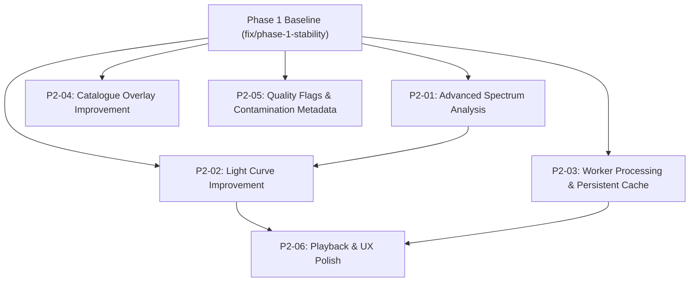

# SkyShift — Phase 2 Execution Plan: Existing Feature Completion & Improvement

**Branch:** `feat/phase-2-completion` (local branch created from `fix/phase-1-stability`)  
**Policy:** Single developer agent; local-only Git operations (never push, merge, or open PRs); scientific accuracy prioritized; one logical task at a time with regression tests after each task.

---

## 1. Dependency Analysis

- **P2-01 → P2-02:** Both share source selection (`tracked` / `selected` / target), proper-motion propagation (`SkyShift.targetPosition` / `propagateProperMotion`), saturated-core handling, and HiDPI `<canvas>` chart rendering.
- **P2-03 (Worker & Persistent Cache):** Independent core infrastructure in `src/archive.ts` and `src/worker.ts`; feeds cache diagnostics into the UI panel.
- **P2-04 (Catalogue Overlays):** Independent proxy + overlay logic in `scripts/catalogue.mjs`, `src/catalogue.ts`, and `src/viewer.ts`.
- **P2-05 (Quality Flags):** Independent flag inspection pipeline in `scripts/read-flags.py`, `scripts/quality.mjs`, and `src/viewer.ts`; uses the selected/tracked sky position.
- **P2-06 (Playback & UX Polish):** Finalizes playback controls, preflight download estimation, wavelength span display, and responsive chart/panel polish across `src/index.html`, `src/style.css`, and `src/viewer.ts`.

---

## 2. Task Breakdown & Acceptance Criteria

### P2-01: Advanced Spectrum Analysis
- **Files:** `src/spectrum.ts`, `src/viewer.ts`, `src/index.html`, `scripts/check-features.mjs`
- **Implementation:**
  - Measure spectrum at the active `tracked` source (with fitted/catalogue motion), `selected` sky position, or active target / field centre.
  - Perform iterative flux-weighted centroiding (`r <= 2.5` px) seeded by proper-motion-propagated coordinates at each exposure's `MJD`, matching `reference/measure_frames.py`.
  - When the core (`r <= 2.5` px) contains `NaN` (saturated/blanked core), compute approximate `3–6` px ring/wing photometry (`mean(sub[wing]) * wing_area * solidAngle * 1e6`) and tag points with `saturated: true, mode: "ring"`.
  - Compute matched-wavelength per-visit brightness comparisons across 3 wavelength sub-bins (`compareSpectrumVisits`) to distinguish true variability from wavelength drift between visits.
  - Render HiDPI spectrum chart coloured by visit with visit legend, error bars, hollow ring markers for saturated points, and matched-wavelength summary.
- **Verification:** Unit and reference-pipeline parity tests in `scripts/check-features.mjs`.

### P2-02: Light Curve Improvement
- **Files:** `src/track.ts`, `src/viewer.ts`, `scripts/check-track.mjs`
- **Implementation:**
  - Seed multi-visit source tracking (`trackSource`) with proper-motion / velocity prediction when available so fast movers (e.g. Barnard's Star, WISE 0855) are tracked across all visits.
  - Plot `#object-curve` against actual MJD / UTC time on the horizontal axis (with UTC date labels), HiDPI scaling, error bars, connected trajectory, active-frame highlight, and distinct lower-limit markers for saturated points.
- **Verification:** Regression tests in `scripts/check-track.mjs`.

### P2-03: Worker Processing and Persistent Cache
- **Files:** `src/archive.ts`, `src/worker.ts`, `src/viewer.ts`, `src/index.html`, `scripts/check-cache.mjs`, `scripts/check-archive.mjs`
- **Implementation:**
  - Add persistent IndexedDB crop caching (`skyshift-crops`) and in-flight request deduplication (`cropInflight`) in `src/archive.ts`.
  - Support worker-side live exposure fetching/processing and progressive visit delivery (`partial` messages) with safe cancellation.
  - Report live cache usage statistics in the Diagnostics panel.
- **Verification:** Cache and worker tests in `scripts/check-cache.mjs` and `scripts/check-archive.mjs`.

### P2-04: Catalogue Overlay Improvement
- **Files:** `scripts/catalogue.mjs`, `src/catalogue.ts`, `src/viewer.ts`, `scripts/check-features.mjs`
- **Implementation:**
  - Order Gaia DR3 (`ORDER BY phot_g_mean_mag ASC`) and CatWISE2020 (`ORDER BY w1mpro ASC`) ADQL queries so bright sources are never truncated by `TOP 250`, and parse magnitude/colour/motion columns.
  - Propagate both Gaia DR3 (epoch 2016.0) and CatWISE2020 (epoch 2015.4) proper motions to the active frame epoch.
  - Support clicking catalogue markers on the map to inspect source ID, magnitude, colour, and motion in the `#whats-here` card.
- **Verification:** Catalogue sorting, parsing, and propagation tests in `scripts/check-features.mjs`.

### P2-05: Quality Flags and Contamination Metadata
- **Files:** `scripts/read-flags.py`, `scripts/quality.mjs`, `src/viewer.ts`, `scripts/check-flag-reader.py`, `scripts/check-features.mjs`
- **Implementation:**
  - Inspect flags at `selected` or `tracked` sky position (falling back to field centre) and display exposure coverage and per-pixel `3 × 3` flag masks clearly.
  - Support both uncompressed ImageHDU and SPHEREx DR1 tile-compressed `FLAGS` BINTABLE HDUs (`GZIP_1` and `RICE_1`) in `scripts/read-flags.py` without requiring `astropy` when standard library decoding suffices.
- **Verification:** Compressed and uncompressed FITS `FLAGS` tests in `scripts/check-flag-reader.py` and `scripts/check-features.mjs`.

### P2-06: Playback and UX Polish
- **Files:** `src/index.html`, `src/style.css`, `src/viewer.ts`, `src/archive.ts`, `scripts/check-archive.mjs`
- **Implementation:**
  - Add `0.5×`, `1×`, `2×` playback speed selector (`#speed`).
  - Add preflight download size estimation (`estimateDownloadBytes`) before/during archive fetches.
  - Show frame/band wavelength spans (`μm`) in the frame readout when available and polish responsive chart/panel layout.
- **Verification:** Full test suite (`npm test`) and build verification.

